<!-- roxyXory · CYBER / Terminal Hacker -->
<div align="center">

  <a href="https://roxyxory.github.io/roxyXory/">
    
  </a>

  <a href="https://roxyxory.github.io/roxyXory/">
    
  </a>
  <a href="https://github.com/roxyXory/roxyXory">
    
  </a>

  

  
  
  
</div>

### `roxyXory@github:~$ cat /etc/profile.d/about.sh`

```bash
#!/usr/bin/env bash
USER="roxyXory"
FOCUS=("Linux" "Windows" "Infrastructure" "Automation")
MOTTO="Learn by doing. Automate the repeatable."
```

### `roxyXory@github:~$ ls /usr/local/toolbox`

<div align="center">
  
  
  
  
  
  
</div>

### `roxyXory@github:~$ systemctl list-units --type=service`

```text
● infrastructure.service       loaded active   Linux & Windows administration
● configuration-mgmt.service    loaded active   Salt master / minion experiments
● network-lab.service          loaded active   Networking, Kerberos & useful services
● scripting.service            loaded active   Bash & PowerShell
```

<details>
  <summary><code>roxyXory@github:~$ ./show-public-stats.sh</code> — expand GitHub activity</summary>

  <p align="center">
    
    
  </p>
  <p align="center">
    
  </p>
</details>

---

<div align="center">

`[ CYBER PROFILE ONLINE ]` · `exit 0` · [**Launch interactive portfolio**](https://roxyxory.github.io/roxyXory/)

</div>
